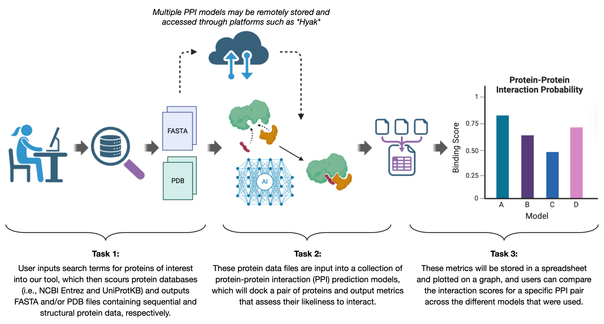

# PPInsight

A Python toolkit for benchmarking computational protein–protein interaction
(PPI) prediction models.  PPInsight automates protein data retrieval, runs
multiple docking engines, collects scores into a unified format, and
produces comparative visualisations.



## Contents

- [Install & quick start](#install--quick-start)
- [CLI reference](#cli-reference)
- [Tutorial](#tutorial)
- [FAQ](#faq)
- [Documentation](docs/README.md)
- [Project structure](#project-structure)
- [Team members](#team-members)
- [License](#license)
- [Resources](#resources)

---

## Install & quick start

### One-command setup

```bash
bash setup.sh          # creates conda env, installs PyRosetta, pip install -e .
conda activate ppinsight
```

> `setup.sh` downloads PyRosetta (~1.5 GB) automatically.  To skip that
> step (e.g. if you only need HADDOCK / LightDock), run
> `bash setup.sh --no-rosetta`.  It also clones and compiles
> [Iter-CONSRANK](https://github.com/AOCD-lab/Iter-consrank) into
> `third_party/iter_consrank/` for `ppinsight consrank`; skip that with
> `--no-iterconsrank`.

<details>
<summary>Manual step-by-step setup</summary>

```bash
conda env create -f environment.yml
conda activate ppinsight
python -c "import pyrosetta_installer; pyrosetta_installer.install_pyrosetta()"
pip install -e .
```
</details>

---

## CLI reference

PPInsight installs an umbrella command (`ppinsight`) with subcommands.
Each subcommand is also available as a standalone command:

| Umbrella form               | Standalone equivalent |
|-----------------------------|-----------------------|
| `ppinsight fetch`           | `protein_fetch`       |
| `ppinsight fetch-native`    | `ppinsight_fetch_native` |
| `ppinsight lightdock`       | `pdb_to_lightdock`    |
| `ppinsight haddock`         | `pdb_to_haddock`      |
| `ppinsight rosetta`         | `pdb_to_rosetta`      |
| `ppinsight collect`         | `collect_scores`      |
| `ppinsight compare`         | `compare_scores`      |
| `ppinsight parse`           | `parse_pairs`         |
| `ppinsight batch`           | `batch_dock`          |
| `ppinsight purge`           | `ppinsight_purge`     |
| `ppinsight quality`         | `ppinsight_quality`   |
| `ppinsight consrank`        | `ppinsight_consrank`  |

The examples below use the umbrella form.  Replace
`ppinsight <subcommand>` with the standalone name if you prefer.

> **Tip:** every command accepts `--help`.  When in doubt, run
> `ppinsight <command> --help` to see all available options.

Before heavy runs, do these quick checks:

```bash
# Check which docking engines are currently runnable/parsible
ppinsight batch --list-engines

# Check which plot types and flags are valid for your scores file
ppinsight compare <scores_file.tsv> --guide
```

### 1. Fetch protein data

PPInsight fetches protein structures for you. You provide UniProt
identifiers, and it downloads sequences and PDB files automatically.
Accepted inputs include canonical accessions (for example `P15692`),
FASTA-style IDs (`sp|P15692|VEGFA_HUMAN`), and common human
gene/name forms such as `VEGFA` or `"VEGFA human"`.

The downloaded structures are saved with the same accession stems you
typed, for example `P69905.pdb`.  That means you can reuse those same
identifiers in later PPInsight steps without manual renaming, including
in the `proteinA` and `proteinB` columns of a batch pairs file.

```bash
# Give one or more UniProt identifiers.
# Downloaded PDB files land in --pdb-dir (default: data/input/)
# as accession-named files such as data/input/P69905.pdb.
ppinsight fetch P69905 P68871

# Name-style human inputs are also accepted and resolved to accessions.
ppinsight fetch "VEGFR2 human" "VEGFA human"
```

Optional flags: `--pdb-dir DIR` (override download location), `--fasta FILE`
(save FASTA sequences), `--csv FILE` (save metadata columns:
ID, Name, Description, Sequence Length, Sequence),
`--pdb-name accession|uniprot|both` (control output filename stems),
`--search TERM` (preview top reviewed-human UniProt matches without
downloading), `--remove ...` (delete mistaken local fetch outputs from
`--pdb-dir`), `--force` (overwrite existing local aliases).
Run `ppinsight fetch --help` for the full list.

### 1b. Find native experimental complexes

Use `ppinsight fetch-native` when you want a candidate native complex for a
specific pair rather than separate single-protein structures. The command
resolves both partners to UniProt accessions, searches RCSB biological
assemblies, and writes a candidate table with method, resolution,
stoichiometry, accession-to-chain mapping, and ready-to-download assembly
URLs.

```bash
# Inspect candidate native assemblies for one pair
ppinsight fetch-native P35968 P15692 \
    -o data/output/native_candidates.tsv

# Search many pairs and review candidate native assemblies
ppinsight fetch-native --pairs tutorials/demo_pairs.tsv \
    -o data/output/native_candidates.tsv

# Download one specific assembly after reviewing the table
ppinsight fetch-native P35968 P15692 \
    --select 3V2A-1 \
    --download-dir data/input/native_complexes
```

Review the candidate table first, then download the exact assembly you want
with `--select`. The `--pairs` input uses the same flat `proteinA` /
`proteinB` table format as `ppinsight batch`.

### 2. Run docking pipelines

Each docking command takes two positional arguments: **receptor** and
**ligand**.  These are PDB filenames (basenames or full paths).  Use
`--input-dir` to tell the CLI where the PDB files live.  By default,
all docking commands search `data/input/`.

```bash
# LightDock — minimum required: receptor, ligand
ppinsight lightdock 2UUY_rec 2UUY_lig --input-dir data/input/

# HADDOCK — minimum required: receptor, ligand
#   Without --run, only stages the config (lets you review before executing).
#   Add --run to also execute HADDOCK3.
ppinsight haddock 2UUY_rec 2UUY_lig --input-dir data/input/ --run

# Rosetta — minimum required: receptor, ligand (needs PyRosetta installed)
ppinsight rosetta 2UUY_rec 2UUY_lig --input-dir data/input/

# PPInsight auto-filters accession-named mixed complexes to accession-mapped
# chains for HADDOCK and Rosetta. Use --no-auto-filter only if you
# intentionally want the full deposited complex. See docs/FAQ.md for details.
ppinsight rosetta P35968 P15692 --input-dir data/input/ --no-auto-filter
```

Each engine has its own tuning flags (swarm count, number of runs,
scoring function, etc.).  Run `--help` to see them:

```
ppinsight lightdock --help
ppinsight haddock --help
ppinsight rosetta --help
```

### 2b. Recommended sampling for ab-initio docking

For ab-initio docking (no prior interface information), use these ranges:

| Engine | Quick Validation | Analysis-grade Default | Heavy/Production |
|---|---:|---:|---:|
| LightDock | `steps=20-50`, `swarms=40-120`, `glowworms=60-120` | `steps=100`, `swarms=400`, `glowworms=200` | `steps>=100`, with larger swarm coverage when resources allow |
| HADDOCK3 rigidbody | `sampling=100-1000` (1000 is minimum defensible analysis-level global sampling), `seletop=50-200` | `sampling=10000`, `seletop=400` | `sampling>=10000`, often with intermediate clustering/selection |
| RosettaDock (global) | `n_runs=100-1000` | `n_runs=5000` | `n_runs=10000-100000` |

The analysis-grade column is PPInsight's batch default [1-6]. HADDOCK's guide
recommends more rigid-body sampling when no interface information is available,
hence `sampling=10000`. Rosetta recommends 10,000–100,000 decoys for a full
global search; PPInsight's 5,000 is a workstation-sized compromise.

References:

1. LightDock simple tutorial (setup/simulation defaults, including 100 steps and default glowworms in `setup.json`): https://lightdock.org/tutorials/0.9.3/simple_docking.html
2. LightDock methods paper: Jimenez-Garcia B. et al., Bioinformatics (2018), https://doi.org/10.1093/bioinformatics/btx555
3. HADDOCK3 sampling module docs (`rigidbody` default `sampling=1000`, recommendation to increase sampling for ab-initio): https://www.bonvinlab.org/haddock3-user-manual/modules/sampling.html and https://www.bonvinlab.org/haddock3-user-manual/abinitio_docking.html
4. HADDOCK3 full vs test workflow examples (`sampling=1000/select=200` in full, lower values in test): https://github.com/haddocking/haddock3/tree/main/examples
5. RosettaDock protocol docs (perturbation runs at least 1000 decoys; global runs 10000-100000): https://docs.rosettacommons.org/docs/latest/application_documentation/docking/docking-protocol
6. RosettaDock methodology papers: Gray J.J. et al., J Mol Biol (2003), https://doi.org/10.1016/S0022-2836(03)00670-3; Marze N.A. et al., Bioinformatics (2018), https://doi.org/10.1093/bioinformatics/bty355

### 3. Collect scores

After docking finishes, collect the raw outputs into a single unified
scores file.  The docking engine is auto-detected from the directory
contents.

```bash
# Point at one or more docking output directories.
# --pair tells collect which proteins are in this run.
# Without -o, collect auto-generates a descriptive TSV path under
# data/output/scores/ and avoids overwriting by adding numeric suffixes.
ppinsight collect data/output/lightdock_runs/2UUY_rec_vs_2UUY_lig/ \
    --pair 2UUY_rec:2UUY_lig
```

You can pass multiple directories (even from different engines) in one
call to build a combined scores file:

```bash
ppinsight collect \
    data/output/lightdock_runs/2UUY_rec_vs_2UUY_lig/ \
    data/output/haddock_runs/2UUY_rec_vs_2UUY_lig/ \
    --pair 2UUY_rec:2UUY_lig \
    -o data/output/scores/combined_scores.tsv
```

Alongside the scores file, `collect` writes a **run record**
(`<scores_file>.provenance.json`) that documents where the numbers came
from, including engine parameters and source directories.  The unified scores
rows also retain lightweight traceability columns when available
(`run_id`, `pose_id`, `output_path`, `source_file`) so you can tie a
plot back to a specific run and pose.

Use `--label-file` (legacy alias: `--pairs`) to add interaction labels.
For mixed multi-pair collections in one command, use `--pair-map`
(`directory,proteinA,proteinB`) or rely on run-directory names such as
`ProteinA_vs_ProteinB`.

Run `ppinsight collect --help` for aggregation options, cluster modes, etc.

### 4. Visualize & compare

```bash
# If you omit -o, compare auto-saves to data/output/plots/
# Violin plot (default) — always prints a tabular summary first
ppinsight compare data/output/scores/scores.tsv --metric dockq

# Strip plot — every pose as a point, with a box summary per engine
ppinsight compare data/output/scores/scores.tsv --metric dockq \
    --plot-type strip -o data/output/plots/strip_dockq.png

# CDF — read off what fraction of poses exceed a threshold
ppinsight compare data/output/scores/scores.tsv --metric dockq \
    --plot-type cdf -o data/output/plots/cdf_dockq.png

# Filter by protein pair and save to PNG
ppinsight compare data/output/scores/scores.tsv --metric dockq \
    --pair 2UUY_rec:2UUY_lig -o data/output/plots/violin_2uuy.png

# Use --show to open interactively instead of auto-saving
ppinsight compare data/output/scores/scores.tsv --metric dockq --show

# Tabular summary only (no plot)
ppinsight compare data/output/scores/scores.tsv --metric dockq --table

# Metric-agnostic overview table (no metric required)
ppinsight compare data/output/scores/scores.tsv --table

# CAPRI quality classification (high/medium/acceptable/incorrect)
ppinsight compare data/output/scores/scores.tsv --capri-quality
ppinsight compare data/output/scores/scores.tsv --plot-type quality_bar \
    --pair 2UUY_rec:2UUY_lig -o data/output/plots/quality.png

# Funnel — rank audit for one target: each engine's own score against
# DockQ measured against the native structure, for the same poses.
# Plot the merged file written by 'ppinsight quality'; funnel takes no --metric.
ppinsight quality data/output/scores/scores.tsv data/input/native.pdb \
    -o data/output/scores/scores_with_dockq.tsv
ppinsight compare data/output/scores/scores_with_dockq.tsv \
    --plot-type funnel -o data/output/plots/funnel.png

# Top-N — same input as funnel: the best DockQ within each engine's top N
# poses (by its own score), for every N.  Compares engines fairly even when
# they output very different numbers of poses.  Takes no --metric.
ppinsight compare data/output/scores/scores_with_dockq.tsv \
    --plot-type topn -o data/output/plots/topn.png

# Scatter — most useful when many pairs are shared across two engines
ppinsight compare data/output/scores/scores.tsv --metric dockq \
    --plot-type scatter --models HADDOCK LightDock \
    -o data/output/plots/scatter_haddock_lightdock.png

# Compare per-model files side by side
ppinsight compare haddock_scores.tsv rosetta_scores.csv \
    --metric score --names HADDOCK Rosetta

# Discover what's in a scores file
ppinsight compare data/output/scores/scores.tsv --list-metrics
ppinsight compare data/output/scores/scores.tsv --list-pairs
```

Run `ppinsight compare --help` for all plot types, filtering, and export options.
Use `ppinsight compare data/output/scores/scores.tsv --guide` for a
data-aware summary of which plot types and flags work with your specific
scores file.

The supported CLI plot types are `violin`, `strip`, `roc`, `scatter`,
`quality_bar`, `cdf`, `funnel`, and `topn`.  `funnel` and `topn` are only
for the native-reference rank audit: they always use each engine's own
score and DockQ for the same poses, so they do not accept `--metric`.
`roc` (and `--classify`) needs a score that every pair has, such as an
engine's own score; DockQ, Fnat and RMSD values are refused there because a
pair that does not bind has no native structure to compare against.

**Two kinds of DockQ.**  HADDOCK reports its own `dockq` (with `fnat`,
`irmsd`, `lrmsd`) from its caprieval step.  These are measured against the
reference HADDOCK was given; PPInsight runs HADDOCK without one, so they
compare each model with HADDOCK's own best-scoring model, which therefore
shows DockQ = 1.0.  They are **not** measured against your native complex.
Plots label them "(HADDOCK caprieval)".  For DockQ against a native
structure, run `ppinsight quality` and use the `quality_*` metrics, e.g.
`--metric quality_dockq`.

### 5. Parse interaction tables & batch-dock

```bash
# Parse a protein interaction table (matrix format) into a flat pairs CSV.
# The pairs file lists (proteinA, proteinB, label) rows.
ppinsight parse data/input/pairs/my_proteins.tsv \
    -o data/input/pairs/pairs.csv --stats

# Batch-dock all pairs — start with --dry-run to preview.
ppinsight batch data/input/pairs/pairs.csv \
    --engines lightdock haddock --dry-run

# Run for real, pointing at the directory with your PDB files.
# --cores (optional) controls CPU cores passed to supported engine runners.
ppinsight batch data/input/pairs/pairs.csv \
    --engines lightdock --pdb-dir data/input/ --cores 8

# Batch-run Rosetta once PyRosetta is installed (can specify # of runs).
ppinsight batch data/input/pairs/pairs.csv \
    --engines rosetta \
    --pdb-dir data/input/ --rosetta-n-runs 50

# Limit to first N pairs for a quick test
ppinsight batch data/input/pairs/pairs.csv --engines lightdock --limit 5
```

The pairs file consumed by `ppinsight batch` has two required columns
(`proteinA`, `proteinB`) and an optional `label` column
(`interaction` / `non-interaction`).  You can create one with
`ppinsight parse` or by hand.  See [`data/README.md`](data/README.md)
for the full format spec.

Batch-mode defaults used when you do not pass extra engine flags:

| Engine | Defaults in `ppinsight batch` |
|---|---|
| LightDock | `steps=100`, `swarms=400`, `glowworms=200`, `cores=1`, `ANM=enabled`, scoring uses the LightDock default |
| HADDOCK | Runs when selected with `--engines haddock`; `ncores` follows `--cores`, generated configs use `rigidbody sampling=10000`, `seletop select=400` |
| Rosetta | Runs when selected with `--engines rosetta` (requires PyRosetta); defaults are `n_runs=5000`, `top_n=20`, `relax=enabled`, `cluster=enabled`, `cluster_top_n=200`, `rmsd_cutoff=4.0`, `auto_filter=enabled`. |

All engine-specific batch flags remain available, so you can still tune LightDock/HADDOCK/Rosetta behavior per run with `ppinsight batch --help`.

Useful batch flags when you need tighter control:

- `--cores N`: set CPU cores for supported runners.
- `--preflight`: validate inputs and engine prerequisites without launching docking.
- `--resume`: skip engine runs already marked successful and save progress after each engine run; reuse the same `-o` results path when resuming. A successful retry replaces its prior failed manifest row.
- `--clean-failed`: with `--resume`, remove a safely recorded failed directory under `--output-root` before retrying it.
- `--screening`: apply the reduced end-to-end preset described below; explicit engine flags override individual preset values.
- `--output-root DIR`: put engine runs and the default batch results table under one root.
- `--lightdock-anm`: enable LightDock ANM flexibility when sufficient memory is available.
- `--lightdock-no-anm`: disable ANM for LightDock.
- `--lightdock-auto-clean-pdb`: auto-clean unsupported non-protein residues and retry that pair.
- `--haddock-sampling N`: set HADDOCK rigidbody sampling in generated configs.
- `--haddock-select-top N`: set HADDOCK `seletop` count in generated configs.
- `--haddock-tolerance N`: set HADDOCK module output-fault tolerance (`rigidbody`, `flexref`, `emref`).
- `--haddock-skip-refinement`: skip HADDOCK `flexref` + `emref` for brittle/smoke-test runs.
- `--haddock-skip-flexref`: skip HADDOCK `flexref` (this also disables `emref`).
- `--haddock-skip-emref`: skip HADDOCK water refinement only (`emref`).
- `--rosetta-n-runs N`: increase Rosetta trajectories per pair.
- `--rosetta-relax`: enable Rosetta FastRelax preprocessing for higher-fidelity runs.
- `--rosetta-no-cluster`: skip Rosetta clustering.

On known LightDock ANM setup atom-mismatch failures, PPInsight will prompt
for confirmation before retrying that pair with ANM disabled.

### Screening settings

Use `--screening` when the goal is to confirm that selected pairs can complete
all three engine integrations before committing to production-scale sampling.
It is an explicit low-cost preset, not a replacement for the production
defaults above:

| Engine | `--screening` settings |
|---|---|
| LightDock | `steps=50`, `swarms=50`, `glowworms=50`, ANM disabled, automatic protein-only retry enabled |
| HADDOCK | `rigidbody sampling=1000`, `seletop select=100`, `flexref` and `emref` skipped |
| Rosetta | `n_runs=100`, `top_n=20`, FastRelax disabled, cluster top 100 decoys |

```bash
# Run a representative, reduced end-to-end batch.
ppinsight batch data/input/pairs/pairs.csv \
    --engines lightdock haddock rosetta \
    --pdb-dir data/input \
    --cores 2 \
    --screening \
    -o data/output/scores/screening_results.csv

# Continue an interrupted screening batch. Reuse the same results file.
ppinsight batch data/input/pairs/pairs.csv \
    --engines lightdock haddock rosetta \
    --pdb-dir data/input \
    --cores 2 \
    --screening \
    --resume \
    -o data/output/scores/screening_results.csv
```

Any explicit engine flag overrides its screening value. For example,
`--screening --haddock-sampling 2000 --rosetta-n-runs 200` keeps the screening
profile but raises sampling for those two engines. `--resume` skips only rows
already marked `ok` in the specified results table.

### Preflight, retry, and cleanup

Run a preflight before an expensive job to check that input PDBs have coordinate
records, required engine executables are available, LightDock inputs do not have
an unmanaged unsupported-residue risk, and HADDOCK's staged partners have unique
chain/segment identifiers. Preflight does not launch docking jobs.

```bash
ppinsight batch data/input/pairs/pairs.csv \
    --engines lightdock haddock rosetta \
    --pdb-dir data/input \
    --preflight \
    -o data/output/scores/preflight_results.csv
```

Failed runs are recorded in the manifest with `error_type`, `error_message`,
and `log_path`, and their `output_dir` is kept for inspection. To retry only
failed runs, removing their partial directories first, reuse the same manifest:

```bash
ppinsight batch data/input/pairs/pairs.csv \
    --engines lightdock haddock rosetta \
    --pdb-dir data/input \
    --screening \
    --resume --clean-failed \
    -o data/output/scores/screening_results.csv
```

Use `ppinsight purge` to clean failed directories from any existing results
manifest. It is a dry run unless `--yes` is supplied, and it removes only paths
under the specified output root:

```bash
# Review removable failed directories.
ppinsight purge data/output/scores/batch_results.csv \
    --output-root data/output

# Delete the reviewed directories.
ppinsight purge data/output/scores/batch_results.csv \
    --output-root data/output --yes
```

### 6. Evaluate docking quality (DockQ)

```bash
# Score a docked model against a native structure
ppinsight quality model.pdb native.pdb

# Append DockQ/CAPRI evaluation rows directly to a collected scores file
ppinsight quality data/output/scores/scores.tsv native.pdb \
    -o data/output/scores/scores_quality.tsv

# Or score a docking run directory directly
ppinsight quality data/output/lightdock_runs/2UUY_rec_vs_2UUY_lig/ native.pdb \
    --engine lightdock \
    -o quality.tsv
```

> Requires the optional `quality` extra: `pip install -e '.[quality]'` from the
> repo root (keep the quotes in `zsh`).

If your scores file came from `ppinsight collect`, `ppinsight quality` reads
each pose from its `output_path` value and appends DockQ/CAPRI evaluation rows
back into a new unified scores file.

### 7. Rank poses without a native structure (Iter-CONSRANK)

DockQ needs an experimental reference.  When there is none, `ppinsight
consrank` ranks poses by *consensus*: each pose is scored by how often its
receptor–ligand contacts recur across the whole pool
([Iter-CONSRANK](https://github.com/AOCD-lab/Iter-consrank), compiled by
`setup.sh`).  Because the score depends only on the pool, poses from
supported docking engines with unrelated native score scales can be ranked
together.

```bash
# Rank one engine's run (engine auto-detected from the directory layout)
ppinsight consrank data/output/rosetta_runs/2UUY_rec_vs_2UUY_lig

# Pool three engines for the same pair.  The :50 suffix keeps only
# LightDock's 50 best-scoring poses (from rank_by_scoring.list) so its
# thousands of glowworm conformations don't swamp the other engines.
ppinsight consrank \
    --pool rosetta=data/output/rosetta_runs/2UUY_rec_vs_2UUY_lig \
    --pool haddock=data/output/haddock_runs/2UUY_rec_vs_2UUY_lig \
    --pool lightdock=data/output/lightdock_runs/2UUY_rec_vs_2UUY_lig:50 \
    -o data/output/scores/2UUY_consrank_pooled.tsv

# The output is a unified scores file: model = source engine per pose
ppinsight compare data/output/scores/2UUY_consrank_pooled.tsv --metric consrank_score
```

Before ranking a pool, `consrank` rewrites every pose onto one shared
scheme — each partner merged into a single chain, hydrogens dropped, and
residues renumbered by sequence alignment to a pool-wide reference — because
CONSRANK identifies contacts by chain and residue number and the engines
don't agree on either.  It prints per-engine alignment coverage/identity and
warns when an engine's poses don't match the rest of the pool (e.g. the
engines docked different chain sets for the pair).  A high CONSRANK score
means "agrees with the pool", not "close to the native"; iterating with
`--cutoff` prunes towards the consensus core.

---

## Tutorial

A complete end-to-end walkthrough is in [`tutorials/README.md`](tutorials/README.md).
It uses pre-computed docking outputs from all three engines, so no external
tools are required.  Start there to see every `ppinsight compare` plot type
and the full collect → compare → classify workflow.

Example output for every plot type is in
[`examples/example_plots/`](examples/example_plots/).

## FAQ

Common setup, plotting, and CAPRI questions are covered in
[`docs/FAQ.md`](docs/FAQ.md).

### Three-layer evaluation

PPInsight supports three complementary comparison layers:

1. Within-model: use `violin`, `strip`, and `cdf` on engine-native scores to inspect one engine's pose distribution.
2. Cross-model: use DockQ/CAPRI-derived metrics with `quality_bar`, `cdf`, and `scatter` to compare engines on the same protein pair when you have an experimental reference structure for that pair. Use `funnel` to check whether each engine's own score ranks its near-native poses first, and `topn` to compare the best DockQ each engine reaches within its top N poses.
3. Cross-model, reference-free: use `ppinsight consrank --pool` to rank poses from several engines by contact-map consensus when no native structure exists.

---

## Project structure

```
src/ppinsight/
  cli.py               # Umbrella ppinsight CLI
  protein_fetch.py      # UniProt / PDB data retrieval
  pdb_to_lightdock.py   # LightDock docking wrapper
  pdb_to_haddock.py     # HADDOCK3 staging & execution
  pdb_to_rosetta.py     # PyRosetta docking wrapper
  collect_scores.py     # Score aggregator (unified TSV/CSV)
  visualizer.py         # Plotting and ppinsight compare implementation
  batch_dock.py         # Batch docking for all pairs
  parse_pairs.py        # Protein interaction table → pairs file
  quality.py            # DockQ quality evaluation
  consrank.py           # Reference-free consensus ranking (Iter-CONSRANK)
  provenance.py         # Run-level metadata & record I/O
  utils.py              # Shared utilities (path resolution)
  rosetta/              # PyRosetta pipeline internals
third_party/            # Vendored Iter-CONSRANK build (created by setup.sh, gitignored)
data/                   # User I/O: input PDBs & pairs → output docking runs
tests/                  # pytest test suite
tutorials/              # End-to-end walkthrough with pre-built scores & sample plots
examples/               # Per-engine sample I/O and test fixtures
docs/                   # FAQ, guides, specs, and use cases
```

### User input & output directories

The **`data/`** directory at the repository root is the default working
directory for pipeline runs.  The pipeline reads from `data/input/` and
writes to `data/output/`.

> `examples/` is for sample data, tutorials, and test fixtures only.

```
data/
├── input/
│   ├── *.pdb              # PDB structures (from ppinsight fetch or manual)
│   └── pairs/             # Batch-mode CSV / TSV files
│
└── output/
    ├── haddock_runs/      # HADDOCK docking outputs
    ├── lightdock_runs/    # LightDock docking outputs
    ├── rosetta_runs/      # Rosetta docking outputs
    ├── consrank_runs/     # CONSRANK working dirs (harmonized poses, per-iteration scores)
    ├── scores/            # Unified scores & batch results
    └── plots/             # Saved figures
```

**Inputs — where to put it**

| What you have                    | Where to put it              |
|----------------------------------|------------------------------|
| PDB structures                   | `data/input/`                |
| Protein interaction table (TSV)  | `data/input/pairs/`          |
| Parsed pairs file                | `data/input/pairs/`          |

**Outputs — where to find it**

| What the tool produces           | Default location                         |
|----------------------------------|------------------------------------------|
| Docking outputs                  | `data/output/<engine>_runs/`             |
| Unified scores file              | auto-named in `data/output/scores/` (or your `-o` path) |
| Batch results table              | `data/output/scores/batch_results.csv`   |
| Run record (provenance)          | `<scores_file>.provenance.json` alongside your scores file |
| Plots / figures                  | auto-saved in `data/output/plots/` (or use `-o` / `--show`) |

All default paths can be overridden with CLI flags (`--input-dir`,
`--pdb-dir`, `--output-root`, `-o`).  See [`data/README.md`](data/README.md)
for the full layout and pairs file format.

### Notes

- For HPC runs, pass an absolute `--output-root` to place outputs on a
  shared or scratch filesystem.
- `--output-root` controls where engine run directories are created in
    batch mode; it does not set the batch results table path (use `-o`).
- External docking tools must be installed separately for the engines
  you want to use.  The HADDOCK helper supports container execution
  (`--container docker|apptainer`).

---

## Team members

| Name | Contributions |
|------|--------------|
| **Ike Keku** | Co-developed PPI predictor pipelines (`pdb_to_haddock`, `pdb_to_lightdock`), oversaw general workflow |
| **Rita Kamenetskiy** | Co-developed protein data fetching (`protein_fetch`), packaging, CI tests |
| **Fiona McLary** | Developed visualiser module |
| **Walter Avila** | Co-developed `protein_fetch` and corresponding tests |
| **Maya Gatt Harari** | Developed Rosetta integration (`ppinsight/rosetta`) |

---

## License

See [LICENSE](LICENSE).

## Resources

- [Biopython Entrez guide](https://biopython.org/wiki/Entrez)
- [RCSB API docs](https://data.rcsb.org/)
- [DockQ](https://github.com/bjornwallner/DockQ)
- [HADDOCK3 docs](https://www.bonvinlab.org/haddock3-user-manual/)
- [LightDock](https://github.com/lightdock/lightdock)
- [Rosetta / PyRosetta](https://rosettacommons.org)

### CAPRI quality classification thresholds

The `--capri-quality` flag and `quality_bar` plot classify docked
predictions into four tiers (high / medium / acceptable / incorrect) from
each pose's DockQ (high ≥ 0.80, medium ≥ 0.49, acceptable ≥ 0.23), using
published community thresholds:

| Source | DOI | Used for |
|--------|-----|----------|
| Basu S, Wallner B (2016). *PLoS ONE* 11(8):e0161879 | [10.1371/journal.pone.0161879](https://doi.org/10.1371/journal.pone.0161879) | DockQ tier thresholds |
| Lensink MF, Velankar S, Wodak SJ (2016). *Proteins* 84(S1):323-348 | [10.1002/prot.25007](https://doi.org/10.1002/prot.25007) | The CAPRI tiers that DockQ's thresholds reproduce |
